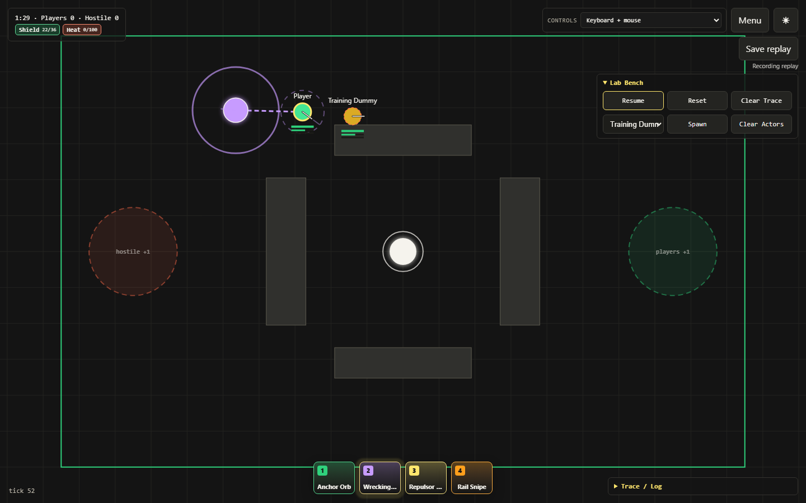
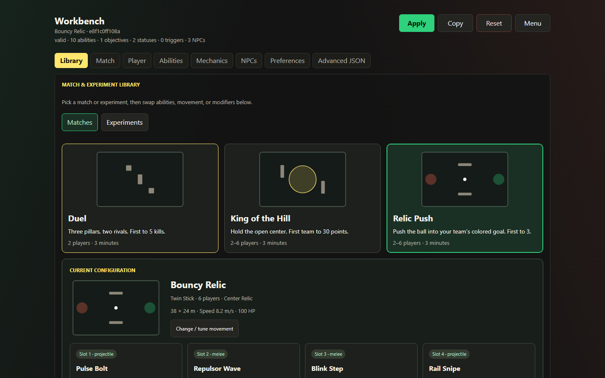

# Beat

[](https://invertedmushroom.github.io/beat/)

**Build an arena. Pick your abilities. Host the match in your browser.**

Beat is a 2D arena game and rules playground for desktop and phones.

The host's browser runs the authoritative Rapier2D simulation in a Web Worker. Players
connect over WebRTC; SpacetimeDB handles finding rooms and exchanging connection details.

[Phone setup](docs/pwa.md#https-on-a-same-wi-fi-phone) ·
[Netcode](docs/networking.md) · [Replay debugger](docs/replays.md)



*Physics Playground in Lab. Spawn actors, cast physics abilities, pause the simulation and inspect what happened.*

## What you can play with

- **Three match kits:** Duel, King of the Hill and Relic Push. Push or shoot the relic
  into a goal, contest a zone, or trade eliminations. Kits support two to six players,
  depending on the mode.
- **Ten ability cards, four slots:** bolts, charged rail shots, melee sweeps, radial
  knockback, dashes, snaring orbs and a tethered wrecking weight. Swap cards and combine
  Turbo Cooldowns, Giant Projectiles and Strong Knockback.
- **Four movement styles:** twin stick with independent aim, turn-to-aim tank controls,
  four-way movement, and platforming with gravity, jumping and air control.
- **Physics you can tune:** push dynamic bodies, strike the relic with weapons, enable
  a bouncy ball, or explore drag, snare and tether effects in Physics Playground.
- **Composable mechanics:** add status effects, resource-driven combos, bleeding and
  conditional low-HP damage. The workbench exposes ability shapes, timings, effects
  and trigger links; validated JSON lets you go further.
- **A live test bench:** spawn training actors and NPCs, pause, reset and inspect
  mechanics and AI traces while testing your loadout.
- **Portable `.beat` replays:** record, export, import, scrub, slow down and step
  through recorded frames. Client clips can overlay a prediction ghost and show the
  error against the authoritative position at the same tick.
- **An installable phone app:** touch movement and drag-to-aim skills, fullscreen,
  screen wake lock and updates deferred during play. After the first complete download,
  practice, the workbench and replay-file playback work offline.



*Choose a match, change movement, swap abilities and add mechanics before hosting the resulting rules.*

### Controls

On desktop, move with **WASD / arrow keys**, aim with the mouse, and cast with
**left click / Space** or **1–4**. Hold charged skills to power them up; they fire
on release or at full charge. On phones, use the movement stick and press-drag-hold
the skill buttons to aim. Movement and aim behavior follow the selected rules and
control profile.

## How rooms work

One browser hosts each room and owns its simulation. Other browsers send inputs to
that host and receive authoritative snapshots. SpacetimeDB provides the room directory,
host identity, join ledger and WebRTC signaling. A TURN service relays WebRTC traffic
when direct connectivity needs help.

The netcode includes four-timestamp affine clock synchronization, tick-aware input
pacing, quantized binary snapshots, deltas against each client's acknowledged baseline,
and reliable keyframe recovery. Local input prediction and short remote extrapolation
use browser-side Rapier physics against arena obstacles. The [networking guide](docs/networking.md)
covers the prediction limits, collision scope and packet-loss recovery.

The host needs to keep its page open; leaving a hosted
room ends that room. Keep a copy of custom rules and export replay files you want to
retain across reloads.

## Run locally

Use Node.js 24, as in the GitHub Actions build, then:

```powershell
npm install
npm run dev
```

Open `http://127.0.0.1:5177`. Solo and Lab run locally without setting up SpacetimeDB.

For a quick multiplayer test, open two tabs on that same origin:

1. In tab A, enter a room name and press **Host**.
2. In tab B, click that room in the room list.
3. Move and cast in either tab.

The default directory uses browser storage and `BroadcastChannel`. It connects tabs
in the same browser; use the SpacetimeDB configuration below for separate devices.

### Playtest on a phone over Wi-Fi

The [phone HTTPS guide](docs/pwa.md#https-on-a-same-wi-fi-phone) includes the complete
`mkcert` recipe, phone CA trust steps and firewall ports. Beat uses
`BEAT_HTTPS_KEY_PATH` / `BEAT_HTTPS_CERT_PATH`, with port **5177** for
`npm run dev:https` and **4177** for `npm run preview:https`.

Use the built preview to test installation, offline caching and service-worker updates.

## Rooms across devices

Copy [.env.example](.env.example) to `.env.local` and configure a SpacetimeDB directory:

```dotenv
VITE_DIRECTORY_DRIVER=spacetime
VITE_STDB_URI=https://maincloud.spacetimedb.com
VITE_STDB_DATABASE=beat-rooms
```

Use a database you have published, or point these settings at your own server.
For cellular, guest Wi-Fi and restrictive networks, also configure
`VITE_ICE_SERVERS_URL` to return an `iceServers` JSON array. The included
[TURN worker](turn-worker/README.md) can mint short-lived Cloudflare TURN credentials.
Explicit `VITE_TURN_URLS`, `VITE_TURN_USERNAME` and `VITE_TURN_CREDENTIAL` are another option;
values supplied through Vite are shipped to the browser.

SpacetimeDB provides discovery and signaling; TURN provides relay connectivity.

<details>
<summary><strong>Build or publish the SpacetimeDB directory</strong></summary>

The TypeScript module lives in `spacetimedb/src/index.ts`. Generated browser bindings
live in `src/module_bindings/`.

```powershell
npm run stdb:build
npm run stdb:generate
```

For a local server, run `spacetime start` in one terminal, then publish from another:

```powershell
npm run stdb:publish:local
```

Set `VITE_STDB_URI=http://127.0.0.1:3000` and
`VITE_STDB_DATABASE=beat-rooms-local` in `.env.local`.

For Maincloud:

```powershell
spacetime login
npm run stdb:publish:maincloud
```

Use `VITE_STDB_URI=https://maincloud.spacetimedb.com` and
`VITE_STDB_DATABASE=beat-rooms`. Configure ICE/TURN separately as described above.
The client and module use SpacetimeDB SDK `2.1.0`; keep the CLI, client and module
versions aligned when upgrading.

</details>

## Explore the implementation

| Guide | What it covers |
| --- | --- |
| [Architecture](docs/architecture.md) | Browser, worker, renderer, workbench and networking ownership. |
| [Rules and room configuration](docs/room-config-guide.md) | Authoring an arena, movement, loadout and mechanics. |
| [Rule semantics](docs/rules-implementation.md) | What each ruleset field does in the simulation. |
| [Engine flow](docs/engine-flow.md) | Ticks, physics, combat, statuses and resources. |
| [Networking](docs/networking.md) | Clock sync, input pacing, compression, prediction and recovery. |
| [Replays](docs/replays.md) | Clip retention, file validation and aligned prediction ghosts. |
| [PWA and phone setup](docs/pwa.md) | HTTPS, installation, offline behavior, updates and wake lock. |
| [SpacetimeDB control plane](docs/stdb-control-plane.md) | Room listings, joins, ownership and signaling. |

## Build and check

```powershell
npm run lint
npm run lint:structural
npm run build
npm test
npm run test:e2e
npm run test:pwa
```

The production PWA suite builds two releases and checks offline play, live-room update
deferral, multiple tabs and failed downloads against real service workers.

## Deploy to GitHub Pages

The [Pages workflow](.github/workflows/pages.yml) builds the static PWA on pushes to
`main`. In GitHub, select **Settings → Pages → Source → GitHub Actions**. The Vite build
uses relative asset paths and supports the project's `/beat/` deployment path.

The workflow targets the `beat-rooms` Maincloud database and configures an ICE provider.
For your own deployment, change those build-time settings and publish the SpacetimeDB
module separately. GitHub Pages serves the app; the host browser runs the live room.

## License

[AGPL-3.0-or-later](LICENSE).
